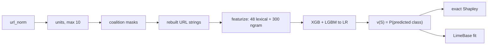

# V3 freeze, V2 null baseline, V3 protocol, segment pilot

Revised 15 Nov 2026 after review. Changes from the first version are listed at the end.

## Step 0: Clean starting commit

The working tree has uncommitted changes: `README.md`, the renamed PDFs, `RSPJ4.txt`, `draft4` and this plan. Commit them first so the freeze can point at a clean `HEAD`.

## Step 1 (run first): Null baseline on V2

This step only reads saved CSVs. It does **not** touch `xai_summary.json`, because `analyze_v2.py` rewrites that file.

New script `malicious_url_xai/null_baseline_v2.py`. It reads [per_url_agreement.csv](malicious_url_xai/results/v2/xai/per_url_agreement.csv) (which holds `pred`, `top5_shap` and `top5_lime`) and `shap_/lime_explanations.csv`, and writes:
- `results/v2/xai/null_baseline.json`, plus `null_baseline_by_class.csv`
- The output is tagged `"analysis": "post-hoc, added <run date> after results were seen"`, with the date taken from the clock when the script runs.

It computes, overall and per predicted class:
- **Uniform chance (exact):** the expected Jaccard of two random 5-subsets of 36 features, computed with the hypergeometric formula (should be about 0.082).
- **Same-class null (exhaustive, so no seed needed):** for every pair i != j within a class, Jaccard of SHAP top-5 of URL i against LIME top-5 of URL j. Report the mean and the 2.5/97.5 percentiles.
- **Same-class Spearman null:** the same pairing applied to the full |value| vectors. This is needed because Draft 4 already claims the benign and phishing correlations are negative.
- **Permutation test:** 10,000 within-class permutations of the LIME assignment (seed 42), giving a two-sided p-value of the observed class mean against the null.

Then update Draft 4 section 3.3 with these numbers and label them post-hoc. The reviewer's extra LIME configurations are **skipped**: [lime_stability.csv](malicious_url_xai/results/v2/xai/lime_stability.csv) already covers 2 seeds and 2,000/10,000 samples in our own pipeline.

## Step 2: Freeze V3

New module `src/freeze.py` with `write_freeze(version, files)` and `check_frozen(version)`, generalising `check_frozen()` from [explain_v2.py](malicious_url_xai/explain_v2.py). New script `freeze_v3.py` refuses to run if `results/v3/freeze.json` already exists.

`results/v3/freeze.json` records:
- **SHA-256 of every file in `artifacts/v3/`.** This is the whole release zip, so it includes `final_model.joblib`, `ngram_vectorizer.joblib`, `feature_names.json`, `feature_manifest.json`, `selected_config.json`, the label encoder, the `stack_base_*` models and the feature parquets. A note explains that the stack bases used at test time live inside `final_model.joblib`, and that `stack_base_train_*` are the validation-stage models.
- **SHA-256 of every file in `results/v3/`, with two exclusions:** `freeze.json` itself, and everything under `results/v3/xai/`. Without these exclusions the manifest would have to contain its own hash, and the pilot's outputs would trip the check.
- **SHA-256 of the source files** that define features and the model: `src/features*.py`, `src/data.py`, `prepare_v3.py`, `train_v3.py`.
- **Release asset (recorded by hand, no download, no API call).** Record that `https://github.com/igaryanthakur/Research/releases/download/v3/v3.zip` (tag `v3`) is the published zip of `artifacts/v3`. The zip's own SHA-256 is recorded as `null` with a note. The per-file hashes of the local folder are what the explainer checks.
- **Environment:** Python, platform, CPU, and the versions of numpy, pandas, scikit-learn, xgboost, lightgbm, catboost, shap, lime, scipy, rapidfuzz, joblib and pyarrow (read with `importlib.metadata`).
- **Git:** the `HEAD` commit, a dirty flag, and `freeze_tool_version`.
- **Policy text:** "Freeze protects against accidental change. The V3 test set was reported for V1/V2 before V3 was designed; V3 results are not pre-registered."

Order of work, so the dirty flag reads clean:
1. Write `src/freeze.py`, `freeze_v3.py` and the test; run pytest; commit.
2. Run `freeze_v3.py`, then `train_v3.py verify`.
3. Commit `freeze.json`.

**Test.** `tests/test_freeze.py` checks `write_freeze` and `check_frozen` on small temporary files (`tmp_path`): an unchanged file passes, a changed file fails, a missing file fails. It does **not** call `check_frozen("v3")`, because that hashes about 810 MB and would run on every pytest invocation. The real check runs once after the freeze and at the start of every `explain_v3.py` run.

## Step 3: V3 protocol (written, committed, approved before any explainer code runs)

New file `documentation/v3_protocol.md`. Its SHA-256 and the commit hash get recorded in every later run's metadata.

**Segments and masking**
- **Unit:** each maximal ASCII `[A-Za-z0-9]+` run in `url_norm`. Other characters are kept as punctuation.
- **Cap:** at most M = 10 units. If a URL has more than 10 segments, merge adjacent segments into 10 contiguous groups using `np.array_split` over segment indices. This allows exact Shapley values with at most 1,024 model calls per URL.
- **Eligibility:** at least 6 raw segments. The protocol reports the eligible share per predicted class over the **whole test set**. This uses segment counting only, with no model calls.
- **Primary masking rule (delete):** remove the unit's characters and keep the punctuation. Two segments can never merge, because punctuation separates them.
- **Secondary masking rule (pilot diagnostic only):** replace each masked unit with `x` repeated to the same length.
- **No re-normalization:** masked strings are featurized exactly as built. `normalize_url` is not applied to them, so a masked string that happens to start with `www.` keeps it.
- **Empty coalition:** v(empty) is the stack's output on the fully masked string. That string is usually punctuation-only, and is `""` if the URL has no punctuation. It must be finite. A unit test covers `""`.

**Value function and explainers**
- **Value function (shared):** v(S) = the stack's probability, for the class predicted on the full URL, on the URL rebuilt from coalition S. The class stays fixed across coalitions. SHAP and LIME call the same `value_fn`.
- **SHAP:** exact Shapley values from all 2^n coalitions, written in our own code using the standard formula. On one pilot URL, cross-check against `shap.ExactExplainer`. This cross-check is time-boxed to 30 minutes; if its masker API does not fit, replace it with an independent brute-force check that averages marginal contributions over all n! orderings on one URL with n = 6.
- **LIME:** `lime.lime_base.LimeBase.explain_instance_with_data`, which is the library's own fitter, fed by our masks, called with `feature_selection="none"` so every unit receives a weight. Sampling follows the installed `LimeTextExplainer` exactly: the first row is the unmasked URL; for each other row the number of units removed is drawn uniformly from 1..n (`randint(1, n + 1)`), so the fully masked string can occur; distance is cosine x 100; kernel width is 25; `Ridge(alpha=1)`. Budget is 1,000 samples. Seed = 42 + row_id. Model calls are separate from SHAP's (no shared cache), so timings stay honest.

**Metrics**
- Rank by |value|, breaking ties by unit position. k = 3. n below always means the number of units after the cap.
- Primary measure: top-3 Jaccard. Also reported: Spearman over all units, and sign agreement on the shared top-3 units.
- **Per-URL chance (exact):** E[J] for two random k-subsets of n is the sum over h of P(h) x h / (2k - h), where P(h) is hypergeometric. Report observed minus chance per URL.
- **Threshold:** mean top-3 Jaccard < 0.50, kept as drafted. The paper reports chance alongside it, because chance ranges from 0.20 at n = 10 to 0.37 at n = 6.
- **RQ1 statistics:** bootstrap 95% CI (10,000 resamples); Wilcoxon of J against per-URL chance.
- **RQ2 statistics:** Kruskal-Wallis across predicted classes on **J minus chance**, not on raw J. Classes differ in unit count (phishing URLs are short, defacement URLs long), and chance depends on unit count, so raw J would differ by class for that reason alone. Raw J by class is still reported descriptively.
- **RQ3 measures:** model calls per explanation is the **primary** measure; wall time is secondary, with a paired Wilcoxon. The paper states that the call counts are set by design: exact SHAP needs 2^n calls (64 to 1,024) and LIME always uses 1,000, so SHAP is cheaper on short URLs by construction.

**Sample**
- Seed 42, drawn from eligible test URLs, stratified by predicted class, with pilot URLs excluded.
- **Size rule:** n_class = min(50, floor(7200 s / (4 x t90))), where t90 is the pilot's 90th-percentile total seconds per URL (SHAP + LIME + overhead).

**Gates, applied in this order (the 20-URL pilot is a smoke test; the protocol says so)**
- **G0, hard checks.** Any failure is a bug, so fix it and rerun:
  - Recomputed features match the `features_v3_full.parquet` row within 1e-6 absolute, which covers the lexical and n-gram blocks. Exact equality is not required: the saved features were built on a different machine, and the TF-IDF values can differ in the last bit.
  - The unmasked output matches `test_predictions.csv` within 1e-5. This is the binding check.
  - Shapley values sum to v(full) - v(empty) within 1e-6.
  - No masked variant crashes or gives a non-finite value.
- **Q1, signal.** Masking must move the model. For each URL take the range of v(S) over all coalitions (maximum minus minimum). The range must be >= 0.10 in at least 14 of 20 URLs, and the median of the largest single-unit deletion effect must be >= 0.05. The range is used, not |v(full) - v(empty)|, because the model may score a punctuation-only string as the predicted class, which would make that gap small even when individual segments matter.
- **Q3, LIME stability.** Mean top-3 self-Jaccard over two LIME seeds >= 0.50.
- **R, runtime.** n_class >= 25.

**Reported, not gated**
- **Q2, LIME fit.** Median weighted R^2 is reported for the pilot and the full run. It does not stop the experiment. Interpretation fixed in advance: if the median is below 0.30, the paper states that LIME's linear surrogate fits the stack poorly on segment masks and treats disagreement as partly a LIME-fit effect, as it does for the V2 study (mean R^2 0.156). Raising the LIME budget is not used as a remedy for fit, because with 6 to 10 units there are at most 1,023 distinct masks and more samples cannot change what a linear model can fit.

**Step-down ladder before any fallback**
- If Q3 fails, raise the LIME budget to 4,000 and rerun the pilot's LIME only.
- If R fails, cut LIME to 500 samples (only if LIME dominates the time), then accept n_class down to 25 (100 URLs).
- If Q1 fails, or the ladder is exhausted, use the **Draft 4 fallback**: V3 classifies and the V2 study is the explanation experiment, kept separate.

**Reporting rules**
- The pilot never computes or prints SHAP-vs-LIME agreement.
- No comparison with V2's 0.17. The paper states that the explanation unit changed from 36 features to URL segments.

## Step 4: Segment explainer and 20-URL pilot

**New `src/explain_v3.py`**, shared later by the experiment and the Streamlit app:
- `segments(url)`, `units(url, M=10)`, `mask(url, units, keep, rule)`
- `featurize(urls)`: batched lexical features plus the vectorizer, column order from `feature_names.json`, same as `_v3_frame` in [check.py](malicious_url_xai/check.py); no normalization inside
- `StackModel.predict_proba(urls)`: force XGBoost to `device="cpu"` and load once
- `exact_shapley(values, n)`, `lime_segments(...)`, `chance_jaccard(n, k)`

**New `explain_v3.py --pilot`.** It calls `check_frozen("v3")` and refuses to run otherwise.
- **Pilot URLs:** 20 test URLs, 5 per predicted class, each eligible, spread over segment-count tertiles, with at least 2 URLs that have more than 10 segments so the merge path is exercised. Drawn with seed 7. Saved to `results/v3/xai/pilot_sample.csv` before anything else runs, so the main sample can exclude them.
- **Outputs** go to `results/v3/xai/pilot/`:
  - per-URL times and model calls
  - n raw and n units
  - LIME R^2 and seed-pair self-Jaccard
  - the G0 check results
  - Q1 signal values (coalition range, largest single-unit deletion effect, and |v(full) - v(empty)| for information)
  - delete-vs-placeholder diagnostic (Spearman of SHAP under each rule, plus the share of masked URLs with an empty hostname)
  - a few example masked URLs
  - `pilot_decision.json` applying G0/Q1/Q3/R, the reported Q2 value, and the resulting n_class
- **Timing conditions:** on charger, Windows Best performance, one warm-up URL outside the sample.

**New `tests/test_explain_v3.py`:**
- segmentation examples
- masking keeps punctuation and never merges segments
- the merge rule gives at most 10 contiguous groups
- Shapley additivity and symmetry on a toy function
- `chance_jaccard` matches brute force for n = 6..10 with k = 3, and gives about 0.082 for k = 5, n = 36
- `featurize("")` is finite

Commit the code before running the pilot. Commit the pilot outputs afterwards.

## Risks flagged
- **Runtime is unmeasured on this pipeline.** Indirect evidence points to one to two seconds per URL: the saved V3 audit shows lexical extraction at about 0.09 ms per URL (on another machine), and `train_v3.py verify` scored 2,000 rows through the stack in about a second on this laptop. If that holds, the size rule reaches its cap of 50 per class. The pilot measures it; which part is slowest is not known until then.
- **Masked hosts like `.com` are out of distribution.** This is reported as a limitation and probed with the placeholder diagnostic.
- **Merging reduces resolution for long URLs,** mostly defacement, whose median is 12 segments. This is reported.
- **Eligibility removes short URLs.** A six-segment minimum excludes about a third of URLs and at least half of phishing URLs. The excluded share per class is reported.

## Changes from the first version (15 Nov 2026 review)
- Q1 now uses the range of v(S) over all coalitions, not |v(full) - v(empty)|.
- Q2 (LIME R^2) is reported with a pre-stated interpretation and no longer stops the experiment; the "raise the budget for Q2" ladder step is removed.
- RQ2's Kruskal-Wallis runs on J minus chance.
- Model calls are the primary RQ3 measure.
- LIME sampling matches the installed library (1..n removed) and uses `feature_selection="none"`.
- G0's feature match uses a 1e-6 tolerance.
- Freeze excludes `freeze.json` and `results/v3/xai/`; its unit test uses temporary files; freeze code is committed before the freeze is run; the release zip is recorded by hand without an API call.
- Masked strings are not re-normalized.
- The unit-type shuffle null is dropped; per-URL exact chance is the only null for V3.
- The `shap.ExactExplainer` cross-check is time-boxed with a brute-force alternative.
- The pilot is 20 URLs (5 per class), not 10.
- Output date tags use the actual run date.
