# Project Documentation – Raw Draft

> **Status:** working draft (end of Day 1, 6 Nov 2026). Every number below comes from a saved file in `malicious_url_xai/results/`. Sections marked **[TBD]** depend on the SHAP/LIME experiments, which have not been run yet. Do not fill them with expected values.

---

## 0. Document map

| Section | Use it for |
|---|---|
| 1–4 | Proposal: title, abstract, problem, RQs, hypotheses, objectives, scope |
| 5 | Literature survey (with verification status) |
| 6–8 | Methodology: dataset, preprocessing, features |
| 9 | Model architecture and all diagrams |
| 10 | Experimental protocol, including the fixed XAI design |
| 11–12 | Results so far and the dataset-artifact finding |
| 13–15 | Limitations, testing, reproducibility |
| 16 | Future XAI work and open items |
| 17 | Reusable text blocks for the proposal, report and paper |

---

## 1. Title

**Working title:**
*Detection of Malicious URLs Using Machine Learning and Explainable AI: A Comparative Study of SHAP and LIME Explanation Agreement and Efficiency*

**Shorter option for a conference paper:**
*Do SHAP and LIME Agree? Explanation Consistency and Cost for a Lexical Malicious URL Classifier*

---

## 2. Abstract (draft)

> Machine-learning classifiers for malicious URL detection are often explained with SHAP or LIME, but studies usually adopt one explainer without checking whether a second one tells the same story, and the cost of producing explanations is rarely measured. We build a four-class (benign, defacement, phishing, malware) lexical URL classifier on a public dataset of 651,191 URLs and compare SHAP (TreeExplainer) and LIME explanations of the same predictions. During preprocessing we found that the dataset encodes class information in URL formatting: a scheme prefix appears in 8.3% of benign URLs but in 100% of defacement URLs. After normalizing the scheme and the leading "www.", 4,047 URLs turned out to carry contradictory labels. On the cleaned data (631,179 URLs), a Random Forest using 24 lexical features reached 84.7% test accuracy (macro-F1 0.827). The same model on raw URLs reached 94.0%, showing that about nine accuracy points come from formatting rather than from malicious content. **[TBD: On a stratified sample of 500 test URLs, SHAP and LIME agreed on X of the top-5 features on average (mean Jaccard = …, Spearman ρ = …); agreement differed/did not differ across classes (Kruskal–Wallis p = …); LIME was … times slower per explanation (Wilcoxon p = …).]** The results suggest that **[TBD]**.

**Keywords:** malicious URL detection, phishing, explainable AI, SHAP, LIME, explanation agreement, dataset artifacts, lexical features.

---

## 3. Problem statement

Several studies apply SHAP or LIME to explain malicious URL classifiers, but most pick one method without comparing it against another. When two explainers give different reasons for the same prediction, an analyst has no basis for deciding which to trust. Prediction overhead is also raised as a concern, yet the time cost of generating explanations is rarely measured. This project examines how consistently SHAP and LIME explain the same malicious URL classifier, and how their computational costs compare.

**Secondary problem found during the work:** the widely used 651k-URL dataset contains a formatting artifact that inflates accuracy. Any explanation study on this dataset must remove it first, otherwise both explainers may simply "agree" on the artifact.

---

## 4. Research questions, hypotheses, objectives, scope

### 4.1 Research questions
- **RQ1:** How well do SHAP and LIME agree on the most influential features for the same URL predictions?
- **RQ2:** Does agreement differ across URL classes (benign, phishing, malware, defacement)?
- **RQ3:** How do SHAP and LIME differ in per-prediction explanation time?

### 4.2 Hypotheses
| | Null (H0) | Alternative (H1) | Test |
|---|---|---|---|
| 1 | Top-5 features of SHAP and LIME largely agree (mean Jaccard ≥ 0.50) | Considerable disagreement (mean Jaccard < 0.50) | Pre-fixed threshold + full distribution |
| 2 | Agreement does not vary across predicted classes | Agreement varies across classes | Kruskal–Wallis on per-URL Jaccard |
| 3 | Per-prediction explanation time is the same | Times differ | Wilcoxon signed-rank (paired) |

**Why 0.50 and not 0.70:** with two sets of five features, Jaccard values are discrete: 5 shared = 1.0, 4 shared = 4/6 = 0.667, 3 shared = 3/7 = 0.429, 2 shared = 2/8 = 0.25. A 0.70 threshold would label 4-out-of-5 agreement as "disagreement". At 0.50, the cut falls between 4 shared features (agreement) and 3 shared features (disagreement). This was fixed before any explanation was generated.

### 4.3 Objectives
1. Review literature on ML-based malicious URL detection and XAI.
2. Extract lexical features and build a multi-class pipeline on a public dataset.
3. Train and compare Logistic Regression, Random Forest and XGBoost using accuracy, precision, recall and macro-F1.
4. Generate SHAP and LIME explanations for the best model on a sample of test URLs.
5. Quantify agreement with top-k Jaccard similarity and Spearman rank correlation, overall and per class.
6. Measure per-prediction explanation time for both.
7. Analyse a sample of disagreement cases.
8. *(Added on Day 1)* Quantify the dataset formatting artifact with an ablation and measure hostname-overlap effects.

### 4.4 Scope
- **In scope:** lexical (URL-string) features only, one public dataset, classical ML, explanations on 500 URLs, single-URL command-line checker (`check.py`).
- **Out of scope:** page content, WHOIS/DNS/network features, deep learning, real-time deployment, browser extension or dashboard.
- **Stated limitation:** agreement shows consistency, not correctness; neither explainer is ground truth.

---

## 5. Literature survey (summary and verification status)

| # | Paper | Venue | Method / data | Relevance | Verified? |
|---|---|---|---|---|---|
| 1 | Poddar, Chowdhury, Dwivedi, Mukkamala – *Data Driven based Malicious URL Detection using Explainable AI* | IEEE TrustCom 2022 | 21 features, 651,191 URLs, 4 classes, stacked ensemble (GB + RF), 97% accuracy, XAI per-feature impact | Same dataset; reported accuracy likely includes the formatting artifact (to discuss carefully) | Full PDF in project folder |
| 2 | *Malicious URL Detection with Explainable Machine Learning Techniques* | ACM ICIECTA 2025 | LR, DT, RF; RF best; SHAP | Single-explainer study; future work: robustness, multi-modal | Full PDF now in project folder; only snippet read so far |
| 3 | *Beyond Classification: Understanding Why URLs Are Malicious with Transparent Convex Optimization and Interpretable XAI* | Springer 2025 | XAI framework for legal/investigative trust and auditability | Motivation: explanations must be trustworthy | Abstract only |
| 4 | *XAI-PhD: Fortifying Trust of Phishing URL Detection Empowered by SHAP* | iJOE 2024 | ML + SHAP for phishing; mentions prediction overhead | Motivates measuring explanation cost | Abstract only; **indexing to verify** |
| 5 | Nair & Di Troia – *A Comparative Analysis of SHAP and LIME in Detecting Malicious URLs* | Springer chapter 2025 | 5 classes; LIME and SHAP per-class key features | **Closest work.** Must check whether it measures agreement quantitatively | **Full text not yet read (critical)** |

**Gap, as currently stated:** existing work typically uses one explainer, or compares SHAP and LIME qualitatively. Quantitative agreement (Jaccard/Spearman per prediction, per class), explanation latency, and a check for dataset artifacts are not, to our knowledge, reported together. *Rephrase after reading Paper 5.* If Paper 5 already measures agreement, position this work as an extension: artifact-free data, latency comparison, per-class statistics, and hostname-overlap analysis.

---

## 6. Dataset

| Property | Value |
|---|---|
| File | `malicious_phish.csv` (Kaggle "Malicious URLs dataset", the same 651,191-URL set used by Paper 1) |
| Columns | `url`, `type` |
| Raw rows | 651,191 |
| Raw classes | benign 428,103 · defacement 96,457 · phishing 94,111 · malware 32,520 |
| Missing values | none |
| Raw exact-duplicate rows | 10,072 |
| Raw conflicting URLs | 6 |
| Licence / original sources | **To verify on the Kaggle page** (commonly described as compiled from ISCX-URL-2016, PhishTank, PhishStorm and malware blacklists) |

---

## 7. Preprocessing

### 7.1 Steps
1. **Schema checks:** columns exactly `url,type`; no nulls; only the four labels.
2. **Normalization:** strip surrounding whitespace, remove `scheme://` and one leading `www.` (case-insensitive). Paths and case are not otherwise changed.
3. **Conflict removal:** any normalized URL with more than one label is removed entirely (all copies).
4. **Deduplication:** keep one row per normalized URL. The first raw string is kept for the raw-URL ablation.
5. **Split:** stratified 70/15/15 (train/validation/test), `random_state=42`, saved with the data.

### 7.2 Cleaning results (`results/data_audit.json`)

| Stage | Rows |
|---|---|
| Raw | 651,191 |
| Removed: conflicting normalized URLs (4,047 URLs) | −8,230 |
| Removed: duplicate normalized URLs | −11,782 |
| **Clean** | **631,179** |

| Class | Raw | Clean | Train | Val | Test |
|---|---|---|---|---|---|
| benign | 428,103 | 423,147 | 296,203 | 63,472 | 63,472 |
| defacement | 96,457 | 95,308 | 66,715 | 14,297 | 14,296 |
| phishing | 94,111 | 89,131 | 62,392 | 13,369 | 13,370 |
| malware | 32,520 | 23,593 | 16,515 | 3,539 | 3,539 |
| **Total** | 651,191 | 631,179 | 441,825 | 94,677 | 94,677 |

Clean normalized URL length: mean 56.9, median 45, max 2,175 characters.

---

## 8. Feature engineering

24 numeric features are computed from the **normalized** URL, using only Python's standard library (`urllib.parse.urlsplit`, `ipaddress`, `re`). No external lookups are made. A scheme-less URL is parsed by temporarily adding `//` in front.

| Group | Feature | Definition |
|---|---|---|
| Length (4) | `url_len` | characters in the URL |
| | `host_len` | characters in the hostname |
| | `path_len` | characters in the path |
| | `query_len` | characters in the query string |
| Character counts (11) | `count_dot`, `count_hyphen`, `count_underscore`, `count_slash`, `count_question`, `count_equal`, `count_at`, `count_amp`, `count_percent` | occurrences of `. - _ / ? = @ & %` |
| | `count_digits`, `count_letters` | digits / letters in the URL |
| Ratios (2) | `digit_ratio` | digits ÷ URL length |
| | `special_ratio` | non-alphanumeric characters ÷ URL length |
| Structure (6) | `subdomain_count` | hostname labels − 2 (0 for IP hosts) |
| | `path_depth` | non-empty path segments |
| | `query_param_count` | `&`-separated query parameters |
| | `host_is_ip` | hostname is an IPv4/IPv6 address |
| | `has_port` | explicit `:port` in netloc |
| | `has_pct_encoding` | contains `%XX` encoding |
| Randomness (1) | `entropy` | Shannon entropy of the URL string |
| **Raw ablation only (2)** | `is_https`, `has_scheme` | computed on the raw URL; never used in the primary model |

The feature matrix is asserted to contain no NaN or infinity and is cached as Parquet.

---

## 9. Model architecture and diagrams

### 9.1 End-to-end system architecture

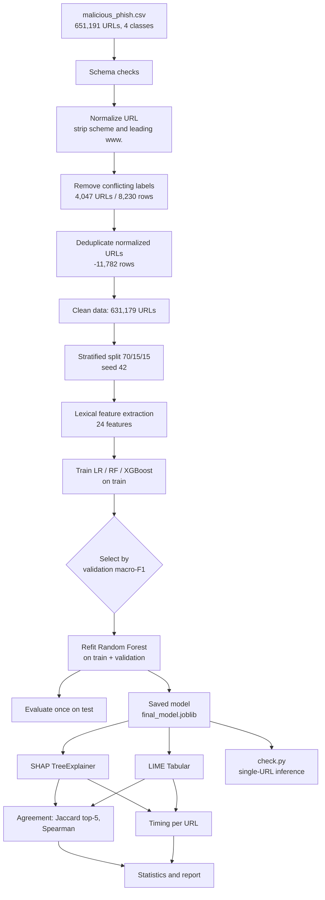

### 9.2 Data-cleaning flow (with counts)

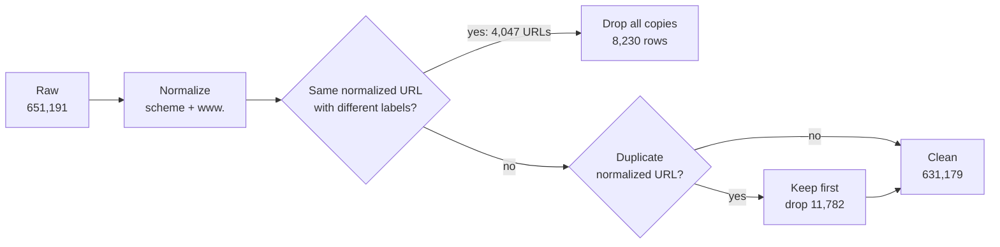

### 9.3 Feature-extraction architecture

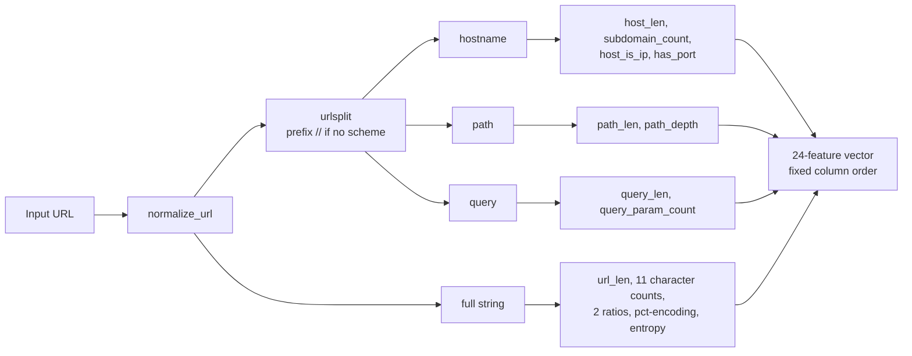

### 9.4 Model training, selection and evaluation

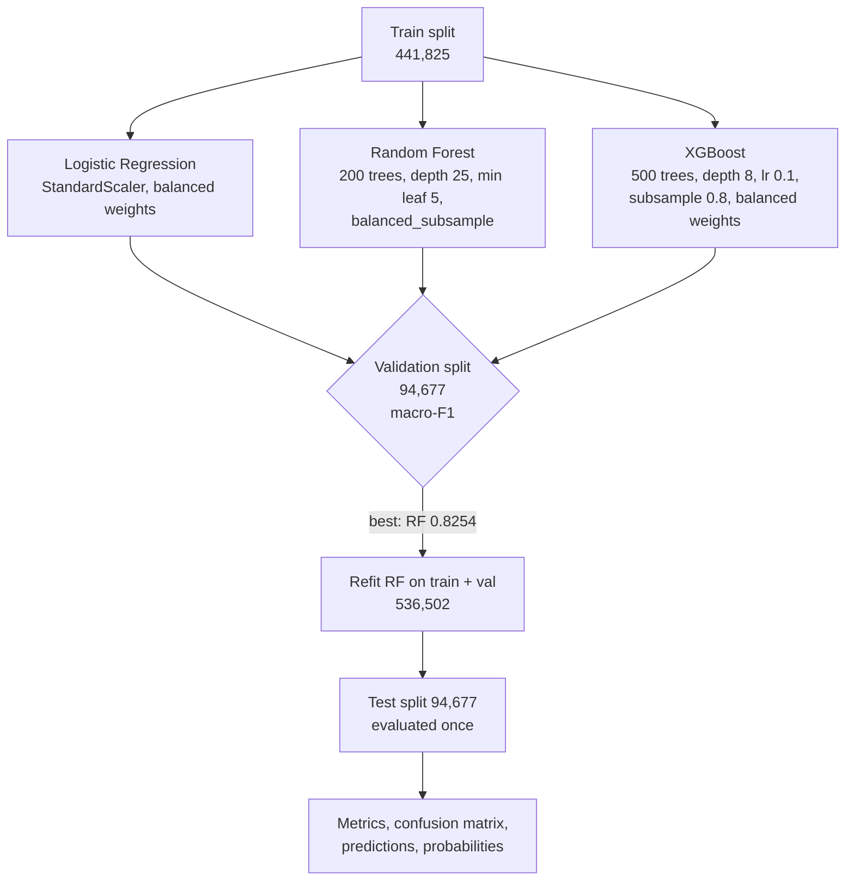

### 9.5 Selected model: Random Forest

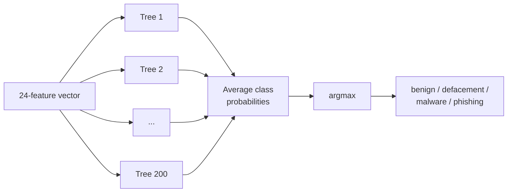

Hyperparameters: `n_estimators=200`, `max_depth=25`, `min_samples_leaf=5`, `max_features='sqrt'`, `class_weight='balanced_subsample'`, `bootstrap=True`, `random_state=42`. The depth and leaf limits keep the model at 565 MB and keep TreeSHAP tractable.

**Why tree models:** `shap.TreeExplainer` computes exact Shapley values efficiently for tree ensembles, and prior work on this dataset reported strong results with trees. SVM, KNN and deep learning were excluded for time and explanation cost.

### 9.6 Three-way ablation design

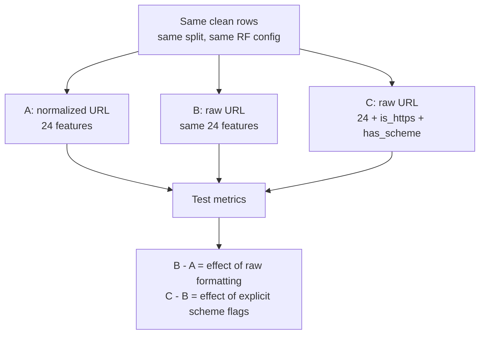

### 9.7 Hostname-overlap subgroup analysis

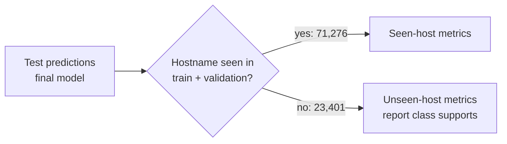

### 9.8 Planned XAI pipeline (explain.py / analyze.py)

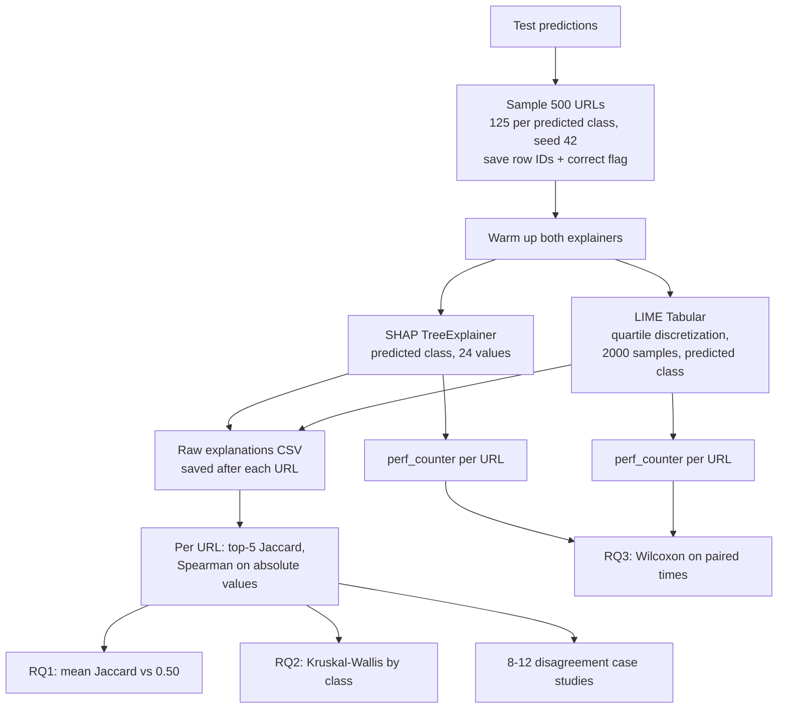

### 9.9 Agreement computation for one URL

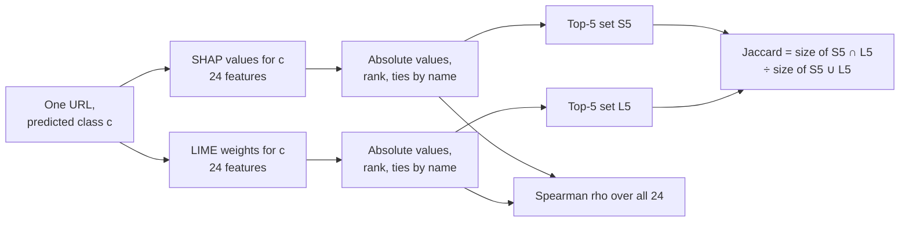

### 9.10 Code and artifact structure

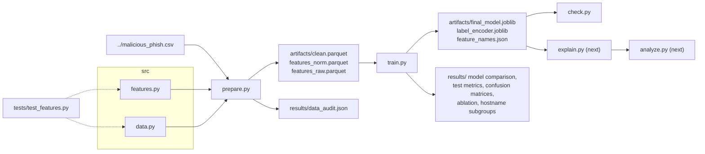

### 9.11 Single-URL inference (check.py)

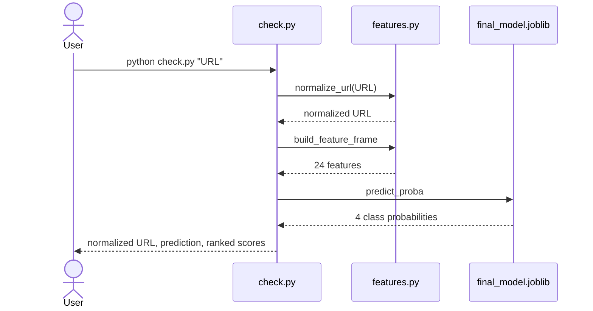

### 9.12 One-week schedule

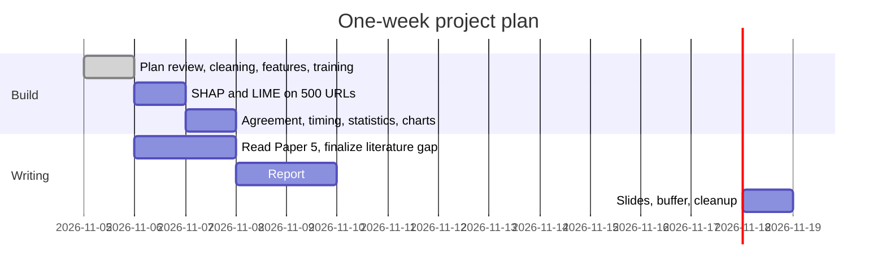

---

## 10. Experimental methodology

### 10.1 Model comparison protocol
- Fit on train only; compare on validation; selection metric is **macro-F1** (secondary: accuracy, macro precision/recall, per-class recall).
- Refit the winner on train+validation; evaluate **once** on test.
- No tuning against the test set; no removal of difficult rows to raise accuracy. 95% accuracy was a target, not a requirement.
- Re-running the pipeline after adding the ablation and subgroup analyses reproduced identical numbers (fixed seeds). No model or feature decision was made after seeing test results.

### 10.2 Model configurations
| Model | Configuration | Imbalance handling |
|---|---|---|
| Logistic Regression | StandardScaler → LR, `max_iter=2000` | `class_weight='balanced'` |
| Random Forest | 200 trees, `max_depth=25`, `min_samples_leaf=5` | `class_weight='balanced_subsample'` |
| XGBoost | 500 trees, depth 8, lr 0.1, subsample 0.8, colsample 0.8, `hist` | balanced sample weights |

All use `random_state=42`. Tuning was deliberately light (one reasonable configuration per model). This is a fairness caveat when comparing RF with XGBoost.

### 10.3 XAI protocol (fixed before running)
| Item | Value |
|---|---|
| Model explained | final Random Forest |
| Sample | 500 test URLs, 125 per **predicted** class, seed 42, from all predictions; `correct` flag saved |
| Class explained | the model's predicted class, for both methods |
| SHAP | `TreeExplainer`; multi-class output shape normalized and asserted |
| LIME | `LimeTabularExplainer`, training subsample, quartile discretization, `random_state=42`, `num_samples=2000`, all 24 features, `as_map()` |
| k | 5 |
| Agreement metrics | top-5 Jaccard; Spearman ρ over absolute importances of all 24 features (NaN if constant, count reported) |
| Disagreement threshold | mean top-5 Jaccard < 0.50 |
| Timing | `time.perf_counter()` per URL, after warm-up, sequential, excluding loading and disk writes |
| Statistics | Wilcoxon signed-rank (time), Kruskal–Wallis (Jaccard by class); pairwise tests only with multiplicity correction |
| Note | Overall mean is class-balanced by design (equal 125 per class) |

---

## 11. Current results and interpretation

### 11.1 Validation comparison
| Model | Accuracy | Macro-P | Macro-R | Macro-F1 | Fit time |
|---|---|---|---|---|---|
| Logistic Regression | 0.5182 | 0.4905 | 0.6618 | 0.4991 | 19 s |
| **Random Forest** | **0.8463** | 0.8110 | 0.8516 | **0.8254** | 55 s |
| XGBoost | 0.8318 | 0.7852 | 0.8587 | 0.8124 | 43 s |

**Interpretation:** Logistic Regression fails (51.8%). This suggests that class boundaries in this feature space are strongly non-linear, for example interactions between length, depth and character counts. RF and XGBoost are close. XGBoost has higher minority-class recall but lower benign recall, so RF wins on macro-F1. With only light tuning, the RF/XGBoost ranking should not be generalized.

### 11.2 Final test performance (Random Forest, test used once)
| Class | Precision | Recall | F1 | Support |
|---|---|---|---|---|
| benign | 0.9472 | 0.8476 | 0.8946 | 63,472 |
| defacement | 0.7539 | 0.8859 | 0.8146 | 14,296 |
| malware | 0.9507 | 0.8878 | 0.9182 | 3,539 |
| phishing | 0.5961 | 0.7924 | 0.6803 | 13,370 |
| **Accuracy** | | | **0.8471** | 94,677 |
| **Macro avg** | 0.8120 | 0.8534 | **0.8269** | |
| Weighted avg | 0.8685 | 0.8471 | 0.8532 | |

**Confusion matrix (rows = true, columns = predicted):**

| | benign | defacement | malware | phishing |
|---|---|---|---|---|
| benign | 53,799 | 3,385 | 96 | 6,192 |
| defacement | 840 | 12,665 | 12 | 779 |
| malware | 151 | 38 | 3,142 | 208 |
| phishing | 2,009 | 712 | 55 | 10,594 |

**Interpretation:**
- Malware is the easiest class (F1 0.92) despite being the smallest.
- Phishing is the hardest (F1 0.68). Its low precision comes mainly from 6,192 benign URLs predicted as phishing. Many phishing URLs are short and imitate ordinary hostnames, so lexical features alone separate them poorly.
- Balanced class weights trade benign recall for minority recall. This lowers accuracy but raises macro-F1, which matches the selection metric.

### 11.3 Hostname-overlap subgroups (test set, final model)
"Seen" means the test URL's hostname also appears in train+validation, the data the final model was fit on.

| Subgroup | n | benign | defacement | malware | phishing | Accuracy | Macro-F1 |
|---|---|---|---|---|---|---|---|
| All test | 94,677 | 63,472 | 14,296 | 3,539 | 13,370 | 0.8471 | 0.8269 |
| Seen host | 71,276 | 47,785 | 14,275 | 2,678 | 6,538 | 0.8694 | 0.8355 |
| Unseen host | 23,401 | 15,687 | **21** | 861 | 6,832 | 0.7792 | 0.6089* |

| Recall | benign | defacement | malware | phishing |
|---|---|---|---|---|
| Seen host | 0.8731 | 0.8857 | 0.9317 | 0.7813 |
| Unseen host | 0.7701 | 1.0* (n = 21) | 0.7515 | 0.8030 |

\* Unreliable. The unseen-host group has only 21 defacement URLs, so its defacement recall and its macro-F1 (dragged down by defacement precision) should not be compared directly with the seen-host group.

**Interpretation:**
- 75.3% of test URLs share a hostname with the training data, which inflates the headline score.
- On unseen hosts, benign recall falls by about 10 points and malware recall by about 18 points.
- Phishing recall does not fall, which suggests phishing detection relies on generalizable lexical patterns.
- Almost all defacement URLs come from hostnames seen in training (many pages of the same defaced sites), so defacement generalization to new sites **cannot be assessed** with this split.

---

## 12. Dataset-artifact finding (key secondary contribution)

### 12.1 Evidence 1: formatting differs by class (raw data)
| Class | Starts with scheme | Starts with `https://` | Starts with `www.` | Median length |
|---|---|---|---|---|
| benign | 8.3% | 0.5% | 3.1% | 46 |
| defacement | 100.0% | 0.0% | 69.8% | 81 |
| malware | 96.3% | 20.8% | 9.3% | 49 |
| phishing | 26.4% | 7.4% | 38.7% | 35 |

Only 0.5% of benign URLs use HTTPS, the reverse of the real web. Formatting reflects how each source recorded URLs, not maliciousness.

### 12.2 Evidence 2: contradictory labels after normalization
- 4,047 normalized URLs carry two labels (the raw file shows only 6). All are **benign vs phishing**:
  - 4,018: the copy with a scheme is labelled phishing, the scheme-less copy benign.
  - 29: the copy with `www.` is labelled phishing, the copy without it benign.
- Example: `http://000067d.rcomhost.com/ssl/dk/sesion/confirm/ID/.../DANSKEBANK-DK/FRAUD/MEMBER-ID/...` is labelled phishing; the identical scheme-less string is labelled benign.
- Interpretation: the scheme-less benign source contains phishing URLs, i.e. label noise that formatting hides.

### 12.3 Evidence 3: three-way ablation (same rows, same RF config, test set)
| Input | Features | Accuracy | Macro-F1 | Recall benign | Recall defacement | Recall malware | Recall phishing |
|---|---|---|---|---|---|---|---|
| Normalized URL (primary) | 24 | 0.8471 | 0.8269 | 0.8476 | 0.8859 | 0.8878 | 0.7924 |
| Raw URL, same features | 24 | 0.9402 | 0.9206 | 0.9434 | 0.9856 | 0.9068 | 0.8854 |
| Raw URL + `is_https`, `has_scheme` | 26 | 0.9466 | 0.9283 | 0.9491 | 0.9938 | 0.9124 | 0.8933 |

**Interpretation:**
- About **9.3 accuracy points** come from the raw string alone. General features such as length, slash count and dot count already encode `http://` and `www.`.
- The explicit scheme flags add only about **0.6 points**. So dropping an "HTTPS feature" is not enough; the URL text itself must be normalized.
- The ~95% accuracy reported on this dataset in prior work is in line with our raw-URL result. It may therefore partly reflect this artifact. *This is shown on our setup only; do not claim it for other papers' exact pipelines.*

---

## 13. Limitations and threats to validity
1. **Lexical features only:** no page content, WHOIS or network signals; phishing precision is limited.
2. **Hostname overlap:** 75.3% of test URLs share a hostname with training; the random split overestimates performance on new sites. A hostname-grouped split was not used, to keep the agreed design.
3. **Defacement generalization untestable:** only 21 unseen-host defacement test URLs.
4. **Residual label noise:** conflicts were removed, but other mislabelled URLs (e.g. phishing inside the benign source) likely remain.
5. **Single dataset**, of unclear provenance and licence (to be verified).
6. **Light hyperparameter tuning** (one configuration per model); RF vs XGBoost ranking is not definitive.
7. **XAI (planned):** agreement measures consistency, not correctness; neither explainer is ground truth. LIME depends on the perturbation count and discretization; SHAP timing is per instance (batching would favour SHAP further). The sample is class-balanced, so the overall mean is not population-weighted.
8. **Normalization choice:** removing `www.` merges URLs that are technically different hosts; accepted because `www.` presence is itself class-skewed in this dataset.

---

## 14. Testing

### 14.1 Unit tests (`tests/test_features.py`, 12 passing)
| Test | What it checks |
|---|---|
| `test_normalize_url` (5 cases) | scheme removal, case-insensitive `www.`, whitespace, `www.` inside path kept, non-HTTP schemes |
| `test_scheme_and_schemeless_parse_same_host_and_path` | identical host/path/query features with and without a scheme |
| `test_ip_port_and_percent_encoding` | IP hosts, explicit ports, `%XX` detection, empty path |
| `test_raw_only_flags` | `is_https`/`has_scheme` correct and absent from primary features |
| `test_entropy_and_empty_string` | entropy values; no division by zero on empty input |
| `test_feature_frame_is_finite_and_deterministic` | malformed URLs (`http://[::1`, invalid port) give finite, repeatable features |
| `test_clean_removes_conflicts_and_normalized_duplicates` | conflicting normalized URLs removed; normalized duplicates dropped |
| `test_splits_are_disjoint_and_stratified` | exact 70/15/15 sizes and class stratification |

### 14.2 Pipeline-level checks
- Schema assertions on load (columns, nulls, label set).
- Assertion that train/validation/test masks are mutually exclusive.
- Assertion that feature matrices contain no NaN/infinity.
- Determinism: full re-run reproduced identical validation and test metrics.
- `check.py`: manual sanity check of single-URL inference (software check only, not evidence of predictive performance).

### 14.3 Still to add (Day 2+)
- SHAP output-shape assertion and LIME 10-URL pilot.
- Test that the saved model loads and outputs valid probability rows.

---

## 15. Reproducibility
| Item | Value |
|---|---|
| Seed | 42 (split, all models, LIME) |
| Python | 3.10.11 (Windows 11, 8 logical CPUs, 16 GB RAM) |
| Key packages | pandas 2.3.3, numpy 2.2.6, scikit-learn 1.7.2, xgboost 3.2.0, shap 0.49.1, lime 0.2.0.1, scipy 1.15.3, matplotlib 3.10.9, seaborn 0.13.2, pytest 9.2.0, pyarrow 25.0.1 |
| Exact environment | `malicious_url_xai/requirements-lock.txt` |
| Run order | `pytest` → `python prepare.py` (~1 min) → `python train.py` (~5 min) → `explain.py` → `analyze.py` |
| Saved outputs | `results/`: data_audit.json, model_comparison_val.csv, test_metrics.json, classification_report.txt, confusion_matrix(_normalized).csv, test_predictions.csv, ablation_raw_vs_normalized.csv, hostname_subgroup_test.csv, run_metadata.json |
| Large artifacts | `artifacts/` (final model 565 MB), excluded from git, regenerated by the scripts |

---

## 16. Future XAI work and open items

### 16.1 Next steps
1. `explain.py`: 10-URL LIME pilot → full 500-URL SHAP + LIME run, saving after each URL.
2. `analyze.py`: Jaccard/Spearman, Kruskal–Wallis, Wilcoxon, figures (Jaccard histogram and boxplot by class, timing boxplot on log scale, top global features per explainer, disagreement case table).
3. Optional robustness checks if time remains: k = 3 and k = 10; LIME `num_samples` 5000 on a subset; agreement for correct vs misclassified predictions; agreement on seen vs unseen hosts.

### 16.2 Open items (must close before writing claims)
- [ ] Read Paper 5 full text (SJSU ScholarWorks / institute library).
- [ ] Verify dataset licence and sources on Kaggle.
- [ ] Verify venue indexing (Scopus/WoS/IEEE), especially iJOE (Paper 4).
- [ ] Read Paper 2 full PDF (now available).
- [ ] Decide: extra lexical features (validation-only) vs proceed directly to XAI (recommended).

### 16.3 Longer-term ideas (paper "future work")
- Hostname-grouped split; second dataset (e.g. a recent PhishTank/OpenPhish snapshot) for cross-dataset validation.
- Content and network features; character-level deep models with gradient-based explainers.
- Additional explainers (e.g. KernelSHAP, Anchors) and faithfulness metrics (deletion/insertion tests) to go beyond agreement.

---

## 17. Reusable text blocks

### 17.1 Contribution statement (paper introduction)
> This paper makes three contributions. First, we show that a widely used malicious URL dataset leaks class information through URL formatting; normalizing the scheme and "www." prefix exposes 4,047 contradictory labels and reduces test accuracy from 94.0% to 84.7% under an otherwise identical pipeline. Second, on the corrected data we quantify agreement between SHAP and LIME explanations of the same Random Forest predictions, overall and per class, using top-5 Jaccard similarity and Spearman rank correlation. Third, we measure the per-prediction cost of both explainers under a controlled timing protocol. **[TBD: one sentence with the main XAI result.]**

### 17.2 Methodology paragraph (report)
> URLs were normalized by removing the scheme and a leading "www." because, in the source dataset, the presence of these elements depends on class origin rather than on maliciousness. Normalized URLs with conflicting labels were removed entirely, and duplicates were collapsed, yielding 631,179 URLs. Data were split 70/15/15 with stratification (seed 42). Twenty-four lexical features were extracted without any network access. Logistic Regression, Random Forest and XGBoost were trained with class-balanced weighting and compared on validation macro-F1; the selected model was refit on training and validation data and evaluated once on the test set.

### 17.3 Dataset-artifact paragraph (results/discussion)
> A three-way ablation isolated the effect of URL formatting. Using the same rows, split and Random Forest configuration, features computed from raw URLs raised test accuracy from 84.7% to 94.0% (macro-F1 0.827 → 0.921), and adding explicit HTTPS and scheme indicators raised it only slightly further to 94.7% (0.928). Most of the inflation therefore arises from formatting differences already captured by generic features such as length and slash count, not from the explicit indicators. Performance figures near 95% on this dataset should be interpreted with this artifact in mind.

### 17.4 Limitations paragraph
> Because the split was random rather than grouped by hostname, 75.3% of test URLs share a hostname with the training data. On test URLs from unseen hostnames, accuracy fell to 77.9%, with benign recall decreasing from 0.873 to 0.770 and malware recall from 0.932 to 0.752, while phishing recall remained stable (0.781 vs 0.803). Only 21 defacement URLs had unseen hostnames, so generalization of defacement detection to new sites could not be assessed. In addition, agreement between SHAP and LIME indicates consistency, not correctness: neither method provides ground-truth feature importance.

### 17.5 Mapping to evaluation rubrics
| Rubric item | Where the material is |
|---|---|
| Sem 3 – Proposal/problem/background/hypothesis (15) | §1–4 |
| Sem 3 – Literature survey (10) | §5 (complete after Paper 5) |
| Sem 3 – Methodology / data collection / analysis (15) | §6–8, §10 |
| Sem 3 – Model development (20) | §9, §11.1–11.2 |
| Sem 3 – Testing (15) | §14, §11.3, §12.3 |
| Sem 4 – Pres. I: abstract/originality, lit review, objectives/scope | §2, §5, §4, §12 (originality angle) |
| Sem 4 – Pres. II: methodology, findings, conclusion | §9–12, XAI results **[TBD]** |

### 17.6 Suggested short-paper outline (6–8 pages)
1. Introduction (problem, contributions §17.1)
2. Related work (§5, condensed)
3. Dataset and the formatting artifact (§6, §7, §12)
4. Method: features, models, XAI protocol (§8, §10)
5. Results: classification, ablation, hostname subgroups, SHAP vs LIME agreement and timing
6. Discussion and limitations (§13)
7. Conclusion and future work (§16.3)

### 17.7 Figures and tables planned for the report
- Fig: end-to-end architecture (§9.1); cleaning flow (§9.2); XAI pipeline (§9.8).
- Fig: normalized confusion matrix heatmap.
- Fig: Jaccard histogram and boxplot by predicted class **[TBD]**.
- Fig: SHAP vs LIME time boxplot, log scale **[TBD]**.
- Table: dataset cleaning (§7.2); validation comparison (§11.1); test report (§11.2); ablation (§12.3); hostname subgroups (§11.3).
