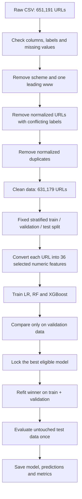
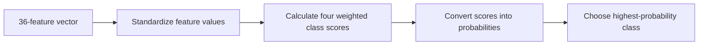
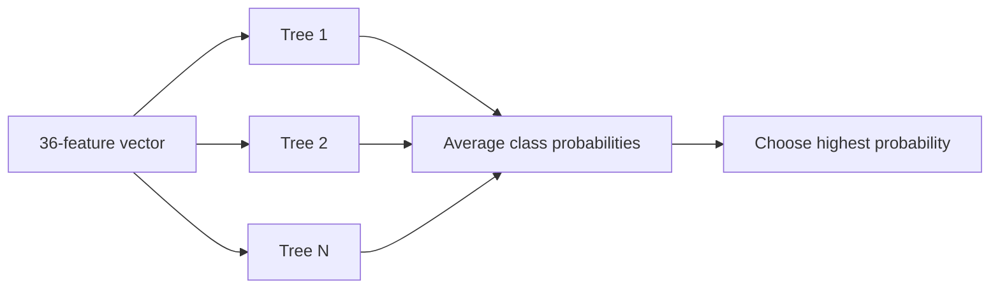
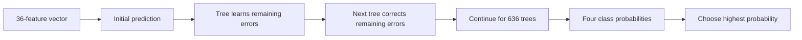
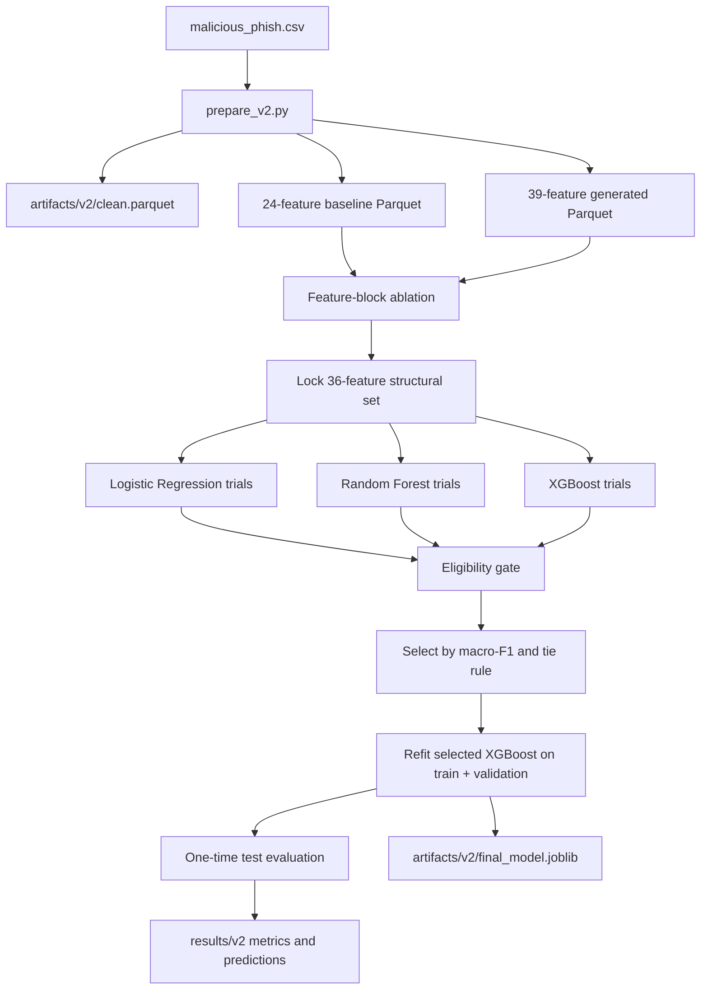

# Project Documentation Draft 2

> **Project:** Detection of Malicious URLs Using Machine Learning and Explainable AI  
> **Status:** working draft after Day 2 model retraining, 6 Nov 2026  
> **Current completed stage:** clean data pipeline, V1 baseline, V2 feature engineering, comparison of Logistic Regression / Random Forest / XGBoost, final one-time test evaluation  
> **Next stage:** explain the frozen V2 XGBoost model with SHAP and LIME  
> **Evidence rule:** numerical results in this document come from saved files under `malicious_url_xai/results/` and `malicious_url_xai/results/v2/`. XAI fields remain marked **[TBD]** until those experiments are run.

---

## 0. Document map

| Section | Purpose |
|---|---|
| 1 | Beginner-friendly explanation of the complete ML system |
| 2–5 | Title, abstract, problem statement, research questions and scope |
| 6 | Literature survey and relation to the IEEE reference study |
| 7–9 | Dataset, preprocessing and feature engineering |
| 10–12 | Model architecture, experimental method and selection rules |
| 13–16 | V1, V2, test, ablation and hostname results |
| 17 | Dataset artifact finding |
| 18–20 | Testing, reproducibility, files and commands |
| 21–24 | Limitations, next steps, reusable report text and completion status |

---

# Part A — Simple explanation for an AI/ML beginner

## 1. What the system does, in simple words

### 1.1 The task

A URL is the address shown in a browser, for example:

```text
https://www.example.com/account/login?id=123
```

The system reads only the URL text. It does not open the website, contact the domain, use WHOIS, or download page content. It predicts one of four classes:

- **Benign:** a normal URL.
- **Defacement:** a page altered by an attacker.
- **Malware:** a URL associated with malicious software.
- **Phishing:** a URL designed to steal information by imitating a trusted service.

This is a **multi-class classification** problem because one input must be assigned to one of more than two classes.

### 1.2 Why a model cannot directly use the URL text

The three selected algorithms expect numbers, not raw strings. Therefore, each URL is converted into a fixed row of numeric **features**.

For example:

```text
Input URL: bank.example.com/account/verify?id=123

Some extracted values:
URL length                 = 38
Hostname length            = 16
Path depth                 = 2
Number of dots             = 2
Number of digits           = 3
First directory length     = 7
Longest path segment       = 7
Top-level-domain length    = 3
```

The model learns patterns from many such rows. It does not use one simple rule such as “long URL = malicious.” It combines several features.

### 1.3 Complete flow from CSV to prediction



### 1.4 Why there are three data splits

- **Training set:** examples used by an algorithm to learn.
- **Validation set:** examples used to compare feature sets, hyperparameters and model families.
- **Test set:** examples kept untouched until every decision is complete.

An analogy is:

- training = studying;
- validation = practice examination;
- test = final examination.

Looking repeatedly at test results while changing the model would be like seeing the final exam questions in advance. The final V2 test stage therefore refuses to run again when its result file already exists.

The split is stratified, meaning every split keeps approximately the same class proportions:

```text
Train      441,825 rows (70%)
Validation  94,677 rows (15%)
Test        94,677 rows (15%)
```

### 1.5 What normalization means and why it matters

Raw URLs in this dataset were recorded differently by different source collections. For example, 100% of defacement URLs had a scheme such as `http://`, but only 8.3% of benign URLs did. A model could therefore learn “the data source” instead of “malicious behaviour.”

Normalization removes:

1. surrounding whitespace;
2. a leading scheme such as `http://` or `https://`;
3. one leading `www.`.

Example:

```text
Before: https://www.example.com/a/b
After:  example.com/a/b
```

This reduced the V1 score, but made it more honest. Scheme, HTTPS and `www` indicators were not reintroduced in V2.

### 1.6 The selected 36 features

All three model families receive the **same 36-column feature table**. The difference is how they learn from it.

#### Group 1: length features

- URL length
- hostname length
- path length
- query length
- first path-directory length
- longest path-segment length
- top-level-domain length
- longest hostname-label length
- fragment length

These describe how large different URL parts are. Malicious campaigns often generate paths or hostnames with distinctive lengths, but no length alone proves that a URL is malicious.

#### Group 2: character-count features

- counts of `.`, `-`, `_`, `/`, `?`, `=`, `@`, `&`, `%`
- counts of `:`, `#`, `+`, `~`, `;`
- letter count and digit count

These describe URL punctuation and composition. For example, query-heavy pages may have more `?`, `&` and `=`, while IP-and-port URLs can contain extra colons.

#### Group 3: ratios and randomness

- digit ratio
- special-character ratio
- Shannon entropy

A ratio corrects for URL length. Entropy is a measure of character diversity or apparent randomness. Generated strings can have different entropy from ordinary words.

#### Group 4: URL structure

- subdomain count
- path depth
- query-parameter count
- hostname-label count
- embedded `//` count after the host

These describe how the URL is organised rather than only how many characters it has.

#### Group 5: Boolean indicators

- hostname is an IP address
- explicit port is present
- percent encoding is present

Each Boolean is represented as `1` for true and `0` for false.

#### Features tested but not selected

Three additional features were created:

- suspicious-token count;
- known URL-shortener host;
- punycode hostname.

They added almost no validation improvement, so the pre-fixed ablation rule excluded them. The generated V2 matrix has 39 columns, but the selected model uses the 24 V1 features plus 12 structural features = **36 features**.

### 1.7 How each model learns

#### Logistic Regression

Logistic Regression learns a weighted mathematical combination of the features. In simple terms:

```text
class score = weight1 × feature1 + weight2 × feature2 + ... + bias
```

It is fast and useful as a baseline, but its boundaries are mainly linear. URL classes depend on non-linear interactions, so Logistic Regression remained weak.



#### Random Forest

A Random Forest contains many decision trees. Each tree asks a sequence of questions such as:

```text
Is path length greater than a threshold?
Is the hostname an IP?
Is the first directory long?
```

Each tree makes a prediction. The forest combines the trees' class probabilities. Trees naturally learn non-linear rules and interactions.



#### XGBoost

XGBoost also uses trees, but builds them **sequentially**. Each new tree focuses on errors left by the earlier trees. Important controls are:

- `n_estimators`: number of boosting trees;
- `max_depth`: maximum depth of each tree;
- `learning_rate`: how strongly each new tree changes the model;
- `subsample`: fraction of training rows used per tree;
- `colsample_bytree`: fraction of features considered per tree.

The selected configuration used:

```text
636 trees
max_depth = 10
learning_rate = 0.1
subsample = 0.8
colsample_bytree = 0.8
square-root balanced class weights
```



### 1.8 Why class weights were used

The classes are imbalanced: benign URLs are much more common than malware URLs. Without compensation, a model can raise accuracy by favouring the majority class.

Three strategies were compared:

- no weighting;
- square-root balanced weighting (moderate);
- fully balanced weighting.

Several unweighted models reached approximately 91–91.3% validation accuracy but only 0.63–0.66 phishing recall. The eligibility gate rejected them. The selected XGBoost used moderate square-root balanced weights.

### 1.9 What the evaluation metrics mean

- **Accuracy:** fraction of all predictions that are correct.
- **Precision for a class:** when the model predicts that class, how often it is correct.
- **Recall for a class:** among real examples of that class, how many the model finds.
- **F1-score:** balance between precision and recall.
- **Macro-F1:** average F1 across all four classes, giving each class equal importance.
- **Weighted-F1:** average F1 weighted by class size.

Accuracy alone is unsafe here because benign is the largest class. Macro-F1 and per-class recall prevent a high-accuracy model from hiding poor minority-class detection.

### 1.10 How to read the final result

The final V2 test accuracy is **90.89%** and macro-F1 is **88.63%**. These do not mean the model will detect 90.89% of all future malicious websites. They mean it achieved those values on this cleaned test partition of this dataset.

The model improved overall, but phishing recall fell from 79.24% to 75.59%. V2 creates fewer false phishing alarms but misses more actual phishing URLs. That trade-off must be reported.

---

# Part B — Formal project documentation

## 2. Working title

**Detection of Malicious URLs Using Machine Learning and Explainable AI: A Comparative Study of SHAP and LIME Explanation Agreement and Efficiency**

Short-paper option:

**Do SHAP and LIME Agree? Explanation Consistency and Cost for a Lexical Malicious URL Classifier**

---

## 3. Updated abstract draft

Machine-learning classifiers for malicious URL detection are often explained with SHAP or LIME, but studies commonly use one explainer without checking whether another gives the same reasons, and explanation cost is rarely measured. We build a four-class lexical URL classifier using a public dataset of 651,191 URLs. A data audit found source-format artifacts: a scheme prefix occurs in 8.3% of benign URLs but 100% of defacement URLs. Removing schemes and leading `www.` exposed 4,047 normalized URLs with contradictory labels. After conflict removal and deduplication, 631,179 URLs remained. A first Random Forest using 24 normalized lexical features achieved 84.71% test accuracy and macro-F1 0.8269, compared with 94.02% accuracy on raw strings. A second, leakage-aware experiment added structural lexical features and compared Logistic Regression, Random Forest and XGBoost using a validation-only selection protocol. The selected 36-feature XGBoost model achieved 90.89% accuracy and macro-F1 0.8863 on an untouched test set evaluated once. It improved benign, defacement and malware recall but reduced phishing recall from 0.7924 to 0.7559. Performance remained weaker on URLs from unseen hostnames (accuracy 0.8357; macro-F1 0.6311), indicating limited cross-host generalization. **[TBD: SHAP/LIME agreement and timing results.]**

**Keywords:** malicious URL detection, lexical features, XGBoost, explainable AI, SHAP, LIME, explanation agreement.

---

## 4. Problem statement

Several studies apply SHAP or LIME to explain malicious URL classifiers, but most select one method without measuring whether another method identifies the same influential features. When two explainers give different reasons for the same prediction, an analyst has no direct basis for deciding which explanation to trust. Explanation-generation overhead is also under-reported.

The classification stage must first produce a credible model. A widely used 651k-URL dataset contains formatting and duplication artifacts that can inflate random-split performance. Explaining such a model would risk explaining the data-collection process rather than malicious behaviour. This project therefore builds a normalized, conflict-cleaned lexical classifier before comparing SHAP and LIME.

---

## 5. Research questions, hypotheses, objectives and scope

### 5.1 Research questions

- **RQ1:** How well do SHAP and LIME agree on the most influential features for the same URL predictions?
- **RQ2:** Does agreement differ across predicted URL classes?
- **RQ3:** How do SHAP and LIME differ in per-prediction explanation time?

### 5.2 Hypotheses

- **H0-1:** Mean top-5 SHAP/LIME Jaccard similarity is at least 0.50.
- **H1-1:** Mean top-5 Jaccard similarity is below 0.50.
- **H0-2:** Agreement does not vary across predicted classes.
- **H1-2:** Agreement varies across predicted classes.
- **H0-3:** Per-prediction explanation time is the same.
- **H1-3:** Explanation times differ.

The 0.50 threshold was fixed before explanation generation. With top-5 sets, four shared features give Jaccard `4/6 = 0.667`, while three shared features give `3/7 = 0.429`.

### 5.3 Objectives

1. Review ML-based malicious URL detection and XAI literature.
2. Extract lexical features and build a four-class pipeline on a public dataset.
3. Train and compare Logistic Regression, Random Forest and XGBoost using accuracy, precision, recall and macro-F1.
4. Generate SHAP and LIME explanations for the selected model.
5. Measure top-5 Jaccard and Spearman agreement overall and per class.
6. Measure per-prediction explanation time.
7. Analyse representative disagreement cases.
8. Quantify dataset-formatting and hostname-overlap effects.

### 5.4 Scope

**In scope**

- One public four-class dataset.
- URL-string lexical features.
- Logistic Regression, Random Forest and XGBoost.
- Validation-only model selection.
- SHAP and LIME on a fixed test sample in the next stage.

**Out of scope**

- WHOIS, DNS, network or page-content collection.
- Deep learning.
- Browser extension, dashboard or production deployment.
- Claiming that explainer agreement proves explanation correctness.

---

## 6. Literature survey

### 6.1 Poddar et al., IEEE TrustCom 2022

*Data Driven based Malicious URL Detection using Explainable AI*

- Same 651,191-URL, four-class dataset.
- 21 URL features.
- 70/30 train/test split.
- Level-0 models: LightGBM, Gradient Boosting, XGBoost and Random Forest.
- Random Forest final estimator with stated five-fold stacking.
- Reported stacked accuracy: 97%.
- Reported macro precision/recall/F1: 0.96/0.95/0.95.
- Uses Accumulated Local Effects (ALE), not SHAP.

Paper-reported individual accuracies:

| Model | Accuracy |
|---|---:|
| LightGBM | 95.62% |
| Gradient Boosting | 95.78% |
| XGBoost | 93.37% |
| Random Forest | 96.58% |
| Stacked ensemble | 97.00% |

The paper inspired first-directory length, TLD length, embedded-link, suspicious-token and shortening features. Its `http`, `https` and `www` count features were intentionally not copied because the local audit shows that formatting depends strongly on class source. The paper does not provide sufficient preprocessing, deduplication, split-seed or hyperparameter detail for exact reproduction.

### 6.2 Other surveyed studies

1. *Malicious URL Detection with Explainable Machine Learning Techniques* (ACM ICIECTA 2025): compares LR, Decision Tree and Random Forest; RF is best; explanations use SHAP.
2. *Beyond Classification: Understanding Why URLs Are Malicious with Transparent Convex Optimization and Interpretable XAI* (Springer 2025): motivates trust, transparency and auditability.
3. *XAI-PhD: Fortifying Trust of Phishing URL Detection Empowered by SHAP* (iJOE 2024): SHAP-based phishing detection and prediction-overhead motivation.
4. Nair and Di Troia, *A Comparative Analysis of SHAP and LIME in Detecting Malicious URLs* (Springer 2025): closest related work; full text must still be checked for quantitative agreement measurement.

### 6.3 Current research gap

The intended contribution is not merely another high-accuracy URL model. It combines:

- removal and measurement of source-format artifacts;
- a clean four-class lexical classifier;
- quantitative per-prediction SHAP/LIME agreement;
- per-class agreement analysis;
- controlled explanation-latency measurement.

---

## 7. Dataset

| Property | Value |
|---|---|
| File | `malicious_phish.csv` |
| Raw rows | 651,191 |
| Columns | `url`, `type` |
| Classes | benign, defacement, phishing, malware |
| Raw class counts | 428,103 / 96,457 / 94,111 / 32,520 |
| Missing values | none |
| Raw duplicate rows | 10,072 |
| Raw conflicting URLs | 6 |
| Dataset SHA-256 | `d83ce942075dd63ed4d11560cfdcd9d512caa3d680e292f22cab484e8f074d01` |
| Licence/original sources | still to verify on the source page |

---

## 8. Preprocessing and split

### 8.1 Cleaning steps

1. Check exact input columns, null values and label set.
2. Strip surrounding whitespace.
3. Remove one leading scheme and one leading `www.`.
4. Find normalized URLs associated with more than one label.
5. Remove every row belonging to those conflicts.
6. Keep one row per remaining normalized URL.
7. Assign the fixed stratified 70/15/15 split using seed 42.

### 8.2 Cleaning results

| Stage | Rows |
|---|---:|
| Raw | 651,191 |
| Rows removed because of 4,047 normalized conflicts | 8,230 |
| Additional normalized duplicates removed | 11,782 |
| Clean | 631,179 |

| Class | Clean | Train | Validation | Test |
|---|---:|---:|---:|---:|
| Benign | 423,147 | 296,203 | 63,472 | 63,472 |
| Defacement | 95,308 | 66,715 | 14,297 | 14,296 |
| Phishing | 89,131 | 62,392 | 13,369 | 13,370 |
| Malware | 23,593 | 16,515 | 3,539 | 3,539 |
| **Total** | **631,179** | **441,825** | **94,677** | **94,677** |

### 8.3 Reproducibility checks

- Rebuilt V2 cleaning reproduces the same row and split counts.
- V2's first 24 columns are asserted row-for-row equal to the V1 extractor.
- Feature matrices have aligned indices and contain no NaN or infinity.
- The V1 RF validation macro-F1 reproduced exactly at 0.8254.
- V1 reproduced accuracy was 0.8459 versus saved 0.8463, within the pre-fixed tolerance of 0.001.

---

## 9. Feature engineering

### 9.1 V1 features: 24

| Group | Features |
|---|---|
| Lengths | `url_len`, `host_len`, `path_len`, `query_len` |
| Counts | dot, hyphen, underscore, slash, question, equal, at, ampersand, percent, digits, letters |
| Ratios | `digit_ratio`, `special_ratio` |
| Structure | `subdomain_count`, `path_depth`, `query_param_count` |
| Indicators | `host_is_ip`, `has_port`, `has_pct_encoding` |
| Randomness | `entropy` |

### 9.2 V2 structural block: 12

| Feature | Meaning |
|---|---|
| Five character counts | colon, hash, plus, tilde and semicolon occurrences |
| `first_dir_len` | length of first non-empty path segment |
| `longest_path_segment_len` | longest path-segment length |
| `tld_len` | final hostname-label length |
| `host_label_count` | hostname-label count |
| `max_host_label_len` | longest hostname-label length |
| `fragment_len` | characters after `#` |
| `embedded_double_slash_count` | `//` occurrences in path/query/fragment |

### 9.3 V2 lexicon block: 3

- exact suspicious-token count;
- exact known-shortener hostname flag;
- punycode-label flag.

Tokens are split with `[a-z0-9]+` and matched as whole tokens. A string such as `mylogin` does not match `login`. A hostname such as `bit.ly.evil.com` does not match the shortener `bit.ly`.

### 9.4 Feature ablation

The unchanged V1 Random Forest was used so that only the feature set changed.

| Feature set | Features | Val. accuracy | Val. macro-F1 |
|---|---:|---:|---:|
| V1 | 24 | 0.8459 | 0.8254 |
| V1 + lexicon | 27 | 0.8481 | 0.8276 |
| V1 + structural | 36 | **0.8839** | **0.8656** |
| Full V2 | 39 | 0.8824 | 0.8641 |

The structural block produced the main gain. The pre-fixed lock rule selected 36 features and excluded the lexicon block.

### 9.5 Character-count caution

The colon feature has a higher mean in defacement and malware URLs than benign URLs. Manual inspection found valid lexical causes such as Joomla `catid=26:` paths and IP-address ports. It is not an explicit scheme/source-format feature. However, repeated templates and campaigns can still act as source proxies, so the documentation uses the careful phrase **“no known explicit source-format leakage features”**, not “no leakage.”

---

## 10. System and model architecture

### 10.1 V2 end-to-end architecture



### 10.2 Why the same features are used for all models

Using the same selected feature table makes the comparison fair. If each algorithm received different input information, a score difference could be caused by features rather than the model.

### 10.3 Why XGBoost was selected

XGBoost learned complex non-linear interactions and achieved the best eligible validation trade-off. Random Forest was close, but XGBoost had higher macro-F1 and better phishing recall under the candidate comparison.

---

## 11. Experimental protocol

### 11.1 Fixed selection eligibility

A candidate was eligible only if:

1. validation accuracy was greater than V1's 0.8463;
2. validation macro-F1 was at least V1's 0.8254;
3. each malicious-class recall was at least 0.70;
4. a malicious-class recall drop greater than 0.05 versus V1 was allowed only when macro-F1 was at least 0.8354.

### 11.2 Selection order

Among eligible candidates:

1. find the highest macro-F1;
2. candidates within 0.005 are treated as near-tied;
3. choose higher accuracy;
4. then higher minimum malicious-class recall;
5. then lower fit time.

Unseen-host validation scores were recorded for diagnosis but not used for selection.

### 11.3 Model searches

**Logistic Regression**

- `C`: 0.1, 1 and 10.
- Weighting: none, square-root balanced and balanced.
- StandardScaler.
- Up to 2,000 iterations, with retry protection for convergence.

**Random Forest**

- Coarse search over depth 25/unlimited, leaf sizes 1/3/5, and none/square-root-balanced weights.
- 300-tree coarse models.
- Selected refinements up to 500 trees with `sqrt` or 0.5 feature sampling.
- 3 GB projected forest-size budget because only about 5.3 GB RAM was free.
- Trees were added in chunks of 50. A test verified that warm-start chunking produces the same probabilities as a single fixed-seed fit.

**XGBoost**

- Depth: 6, 8 and 10.
- Learning rate: 0.05 and 0.1.
- Weighting: none and square-root balanced.
- `subsample=0.8`.
- `colsample_bytree=0.8`.
- Up to 1,000 trees with validation-log-loss early stopping after 50 non-improving rounds.

### 11.4 Test protection

- The test set was not used for feature locking, tuning, eligibility or model selection.
- Early stopping observed validation only.
- The winning tree count was fixed from validation.
- The winner was refit on train+validation.
- `train_v2.py final` refuses to run while `results/v2/test_metrics.json` exists.
- The final V2 test evaluation was run once.

---

## 12. Model comparison on validation

Best candidate from each required family:

| Family | Best configuration summary | Accuracy | Macro-F1 | Phishing recall | Eligible |
|---|---|---:|---:|---:|---|
| Logistic Regression | C=10, sqrt-balanced | 0.7564 | 0.6511 | 0.3234 | No |
| Random Forest | 500 trees, unlimited depth, leaf 3, sqrt features/weights | 0.9064 | 0.8799 | 0.7063 | Yes |
| XGBoost | depth 10, lr 0.1, sqrt-balanced | **0.9070** | **0.8841** | **0.7495** | Yes |

An XGBoost candidate with learning rate 0.05 had a slightly higher macro-F1 (0.8846), but it was within the pre-fixed 0.005 tie range. The selected 0.1 candidate had higher accuracy (0.9070 versus 0.9069) and lower fit time.

Several unweighted candidates reached validation accuracy from 0.910 to 0.913 but had phishing recall from approximately 0.63 to 0.66. They were rejected by the pre-fixed recall gate.

---

## 13. Final selected model

| Item | Value |
|---|---|
| Family | XGBoost |
| Features | 36 normalized lexical features |
| Trees | 636 |
| Maximum depth | 10 |
| Learning rate | 0.1 |
| Row subsample | 0.8 |
| Feature subsample | 0.8 |
| Weighting | square-root balanced |
| Random seed | 42 |
| Final fitting data | train + validation |
| Model size | 55.9 MB |
| Final fit time | 90.8 seconds |
| Test prediction time | 1.8 seconds for 94,677 rows |

Final train+validation class weights:

```text
benign      0.6107
defacement  1.2867
malware     2.5862
phishing    1.3306
```

---

## 14. Final untouched-test results

| Class | Precision | Recall | F1 | Support |
|---|---:|---:|---:|---:|
| Benign | 0.9425 | 0.9345 | 0.9385 | 63,472 |
| Defacement | 0.9033 | 0.9395 | 0.9211 | 14,296 |
| Malware | 0.9671 | 0.9053 | 0.9352 | 3,539 |
| Phishing | 0.7451 | 0.7559 | 0.7504 | 13,370 |
| **Macro average** | **0.8895** | **0.8838** | **0.8863** | 94,677 |
| **Weighted average** | **0.9096** | **0.9089** | **0.9092** | 94,677 |

**Accuracy: 0.9089**

### 14.1 Confusion matrix

Rows are true classes; columns are predicted classes.

| True \\ Predicted | Benign | Defacement | Malware | Phishing |
|---|---:|---:|---:|---:|
| Benign | 59,314 | 1,056 | 37 | 3,065 |
| Defacement | 626 | 13,431 | 9 | 230 |
| Malware | 157 | 15 | 3,204 | 163 |
| Phishing | 2,835 | 366 | 63 | 10,106 |

### 14.2 Interpretation

- Benign, defacement and malware each have F1 above 0.92.
- Phishing remains hardest, with F1 0.7504.
- The model greatly reduces benign URLs incorrectly flagged as phishing.
- It also misses more phishing URLs than V1; this is a real security trade-off.

---

## 15. V1 versus V2

| Metric | V1 | V2 | Change |
|---|---:|---:|---:|
| Test accuracy | 0.8471 | **0.9089** | +0.0618 |
| Test macro precision | 0.8120 | **0.8895** | +0.0775 |
| Test macro recall | 0.8534 | **0.8838** | +0.0304 |
| Test macro-F1 | 0.8269 | **0.8863** | +0.0594 |
| Benign recall | 0.8476 | **0.9345** | +0.0869 |
| Defacement recall | 0.8859 | **0.9395** | +0.0536 |
| Malware recall | 0.8878 | **0.9053** | +0.0175 |
| Phishing recall | **0.7924** | 0.7559 | −0.0365 |
| Model size | 565.0 MB | **55.9 MB** | −509.1 MB |

The improvement is not only from tuning: the unchanged V1 RF improved from validation accuracy 0.8459 to 0.8839 when given the structural features. XGBoost then improved the selected validation result to 0.9070.

### 15.1 Phishing trade-off in concrete counts

- Benign URLs incorrectly predicted as phishing fell from 6,192 to 3,065.
- Phishing URLs incorrectly predicted as benign increased from 2,009 to 2,835.
- Therefore, V2 creates many fewer false phishing alarms but misses 826 additional phishing examples in the test set.

The report must not claim that V2 is better on every class. It is better overall and much more precise for phishing, but less sensitive to phishing.

---

## 16. Hostname-overlap analysis

“Seen hostname” means the test URL hostname occurs in train+validation, which was used for final fitting.

| Group | n | Accuracy | Macro-F1 | Benign R | Defacement R | Malware R | Phishing R |
|---|---:|---:|---:|---:|---:|---:|---:|
| All test | 94,677 | 0.9089 | 0.8863 | 0.9345 | 0.9395 | 0.9053 | 0.7559 |
| Seen hostname | 71,276 | 0.9330 | 0.9022 | 0.9535 | 0.9394 | 0.9537 | 0.7605 |
| Unseen hostname | 23,401 | 0.8357 | 0.6311 | 0.8766 | 1.0000* | 0.7549 | 0.7515 |

`*` Only 21 unseen-host defacement URLs exist, so defacement recall and the resulting subgroup macro-F1 are unstable.

Compared with V1, unseen-host accuracy rose from 0.7792 to 0.8357 and macro-F1 from 0.6089 to 0.6311. This supports some genuine generalization improvement, but performance remains substantially lower than on familiar hostnames.

---

## 17. Dataset artifact finding

### 17.1 Formatting by class

| Class | Starts with scheme | Starts with HTTPS | Starts with `www.` |
|---|---:|---:|---:|
| Benign | 8.3% | 0.5% | 3.1% |
| Defacement | 100.0% | 0.0% | 69.8% |
| Malware | 96.3% | 20.8% | 9.3% |
| Phishing | 26.4% | 7.4% | 38.7% |

Only 0.5% of benign URLs use HTTPS, which is unrealistic for the modern web and indicates collection-source formatting.

### 17.2 Contradictory labels

Normalization exposed 4,047 URL strings associated with both benign and phishing labels:

- 4,018 scheme-based conflicts;
- 29 `www`-based conflicts.

All copies of conflicting URLs were removed instead of guessing a label.

### 17.3 Raw versus normalized V1 ablation

| Input | Features | Test accuracy | Test macro-F1 |
|---|---:|---:|---:|
| Normalized URL | 24 | 0.8471 | 0.8269 |
| Raw URL, same general features | 24 | 0.9402 | 0.9206 |
| Raw + explicit scheme flags | 26 | 0.9466 | 0.9283 |

About 9.3 accuracy points came from raw formatting. This explains why a clean model should not be judged against a leakage-prone 95–97% target.

---

## 18. Testing and quality checks

The complete test suite was rerun after this documentation update: **40 tests passed in 1.74 seconds** under Python 3.13.14.

### 18.1 V1 tests retained

The original 12 tests cover normalization, parser behaviour, IP/port/encoding, entropy, deterministic finite values, conflict removal, deduplication and split stratification.

### 18.2 V2 feature tests

The V2 suite checks:

- 39-column generated schema and ordering;
- no HTTP/HTTPS/scheme/`www` feature names;
- finite deterministic output for valid and malformed URLs;
- path segments and hostname labels;
- IP and IPv6 handling;
- fragment and embedded `//` behaviour;
- whole-word suspicious-token matching;
- exact shortener-host matching;
- punycode detection;
- normalization invariance;
- exact equality of the first 24 V2 columns to V1;
- feature-manifest contents.

### 18.3 Pipeline smoke tests

Tests cover:

- class-weight calculations;
- tie-rule ordering;
- eligibility rules;
- chunked RF equivalence to one-shot RF;
- RF and XGBoost artifact serialization/reloading;
- four-class finite probabilities that sum to one.

### 18.4 Final artifact verification

After final fitting:

- saved model and encoder reloaded successfully;
- model classes match encoded classes;
- probabilities are finite and sum to one;
- reloaded predictions match the first 5,000 saved test predictions.

---

## 19. Run corrections and audit trail

Two implementation problems occurred during tuning:

1. RF refinement initially selected candidates from all coarse trials rather than eligible trials. One additional refinement trial ran. It remains in the raw trial log, is marked superseded, and is excluded from final selection.
2. The selection stage initially failed because of a missing derived column. The code was corrected and only selection was rerun; no model was retrained and the test set had not been accessed.

Neither issue changed the final test protocol.

Two small housekeeping items remain:

- make the code apply the eligible-only ordering directly before winner selection; recalculating the intended rule from the saved eligible candidates gives the same XGBoost winner;
- store a feature hash for the selected 36 columns rather than the full generated 39-column manifest.

These are reproducibility-metadata corrections and do not require retraining or another test evaluation.

---

## 20. Reproducibility and project structure

### 20.1 Environment

| Item | Value |
|---|---|
| OS | Windows 11 build 26300 |
| Python | 3.13.14 for V2 |
| CPU | Intel64 Family 6 Model 154, 8 logical CPUs |
| RAM | 16 GB; approximately 5.3 GB free before tuning |
| NumPy | 2.2.6 |
| pandas | 2.3.3 |
| scikit-learn | 1.7.2 |
| XGBoost | 3.2.0 |
| Seed | 42 |

### 20.2 V2 files

```text
malicious_url_xai/
├── src/
│   ├── data.py
│   ├── features.py
│   ├── features_v2.py
│   └── runinfo.py
├── tests/
│   ├── test_features.py
│   ├── test_features_v2.py
│   └── test_pipeline_v2_smoke.py
├── prepare.py
├── train.py
├── prepare_v2.py
├── train_v2.py
├── artifacts/v2/
│   ├── clean.parquet
│   ├── features_v1_norm.parquet
│   ├── features_v2_norm.parquet
│   ├── feature_manifest.json
│   ├── final_model.joblib
│   ├── label_encoder.joblib
│   ├── feature_names.json
│   └── selected_config.json
└── results/v2/
    ├── data_audit.json
    ├── feature_ablation_val.csv
    ├── feature_set_lock.json
    ├── model_trials_val.csv
    ├── model_trials_ranked_val.csv
    ├── model_comparison_val.csv
    ├── selection.json
    ├── test_metrics.json
    ├── classification_report.csv
    ├── confusion_matrix.csv
    ├── test_predictions.csv
    ├── hostname_subgroup_test.csv
    ├── v1_vs_v2.csv
    ├── run_metadata.json
    └── logs/
```

### 20.3 Commands

From `malicious_url_xai/` with its virtual environment active:

```powershell
pytest
python prepare_v2.py
python train_v2.py baseline ablation lr rf xgb select final verify
```

The tuning file is append-only and completed trials are skipped by ID, allowing a stopped run to resume.

---

## 21. Limitations and threats to validity

1. **Single dataset:** results may not transfer to current URLs or another collection.
2. **Unverified licence/provenance:** the exact dataset licence and source composition still require confirmation.
3. **Random URL-level split:** 75.3% of test URLs share a hostname with final training data.
4. **Defacement host imbalance:** only 21 unseen-host defacement examples prevent reliable generalization measurement.
5. **Residual label noise:** normalization removed known conflicts, but other incorrect labels may remain.
6. **Lexical-only input:** page content and network behaviour are unavailable.
7. **Phishing recall trade-off:** V2 misses more phishing examples than V1.
8. **Validation reuse:** XGBoost early stopping and model selection both use validation, making validation slightly optimistic. Test remains untouched.
9. **No absolute no-leakage claim:** structural patterns may still represent repeated sources or campaigns.
10. **Light bounded search:** comparison covers reasonable configurations, not every possible hyperparameter.
11. **Future XAI:** SHAP/LIME agreement measures consistency, not correctness.

---

## 22. Next stage: frozen XAI experiment

The selected XGBoost model and 36-column feature order should now be frozen. No further classifier tuning should use the existing test set.

Planned explanation protocol:

- sample 500 test predictions, balanced across predicted classes;
- explain the same predicted class with both methods;
- TreeSHAP for XGBoost;
- LIME Tabular with fixed seed and perturbation count;
- top-5 Jaccard agreement;
- Spearman correlation over all 36 absolute importance values;
- per-class agreement comparison;
- paired per-URL explanation timing;
- disagreement case studies;
- optional correct-versus-incorrect and seen-versus-unseen analyses if time permits.

XGBoost TreeSHAP output shape must be checked under the installed SHAP version before the full run.

---

## 23. Reusable report text

### 23.1 Classification methodology

> The dataset was normalized by removing the scheme and one leading `www.` because these formatting elements were strongly associated with source class. Normalized URLs with contradictory labels were removed entirely and duplicates were collapsed, yielding 631,179 URLs. A fixed stratified 70/15/15 split was used. Twenty-four baseline lexical features and fifteen candidate V2 features were extracted without network access. Feature-block ablation selected the baseline plus twelve structural features. Logistic Regression, Random Forest and XGBoost configurations were compared on validation data using macro-F1, accuracy and pre-fixed minority-recall eligibility constraints. The selected XGBoost configuration was refit on train and validation data and evaluated once on the untouched test set.

### 23.2 Model result

> The selected 36-feature XGBoost classifier achieved 90.89% test accuracy and macro-F1 0.8863, improving over the 24-feature Random Forest baseline of 84.71% accuracy and macro-F1 0.8269. The new model improved benign, defacement and malware recall, while phishing recall decreased from 0.7924 to 0.7559. This trade-off arose because false phishing alarms decreased substantially: benign-to-phishing errors fell from 6,192 to 3,065.

### 23.3 Generalization limitation

> Approximately 75% of test URLs shared their hostname with data used for final fitting. V2 accuracy was 0.9330 on seen hostnames and 0.8357 on unseen hostnames. Unseen-host macro-F1 was 0.6311, but this value is unstable because only 21 unseen-host defacement URLs were available. The random-split score therefore should not be interpreted as performance on entirely new websites.

### 23.4 Dataset artifact contribution

> A controlled ablation showed that raw URL formatting raised V1 test accuracy from 84.71% to 94.02% with the same general feature set, while explicit scheme flags raised it to 94.66%. Normalizing scheme and `www.` also exposed 4,047 URLs with contradictory benign/phishing labels. Consequently, the final V2 model excludes scheme, HTTP/HTTPS and `www` indicators and reports lower but more defensible performance than leakage-prone raw-URL experiments.

### 23.5 Current contribution statement

> This work first identifies and controls a source-format artifact in a widely used malicious-URL dataset. It then shows that twelve normalized structural lexical features improve a 24-feature Random Forest baseline and that a moderately class-weighted XGBoost model achieves 90.89% accuracy and macro-F1 0.8863 on the untouched cleaned test set. The next stage will quantify whether SHAP and LIME provide consistent explanations of this frozen classifier and compare their explanation costs.

---

## 24. Current completion status

### Completed

- Dataset audit, normalization, conflict removal and deduplication.
- Fixed train/validation/test split.
- V1 feature extraction and LR/RF/XGBoost comparison.
- Raw-format artifact ablation.
- V2 structural and lexicon feature implementation.
- Feature-block ablation and feature lock.
- Bounded LR/RF/XGBoost tuning.
- Eligibility-based model selection.
- One-time final test evaluation.
- Hostname subgroup evaluation.
- Artifact serialization and reload verification.

### Still open

- Apply two minor selection/feature-hash housekeeping corrections without reevaluating test.
- Read the closest SHAP/LIME paper in full.
- Verify dataset licence and surveyed venue indexing.
- Implement SHAP/LIME pilot, full explanation run and statistical analysis.
- Update this draft with XAI results, figures, final conclusion and references.

